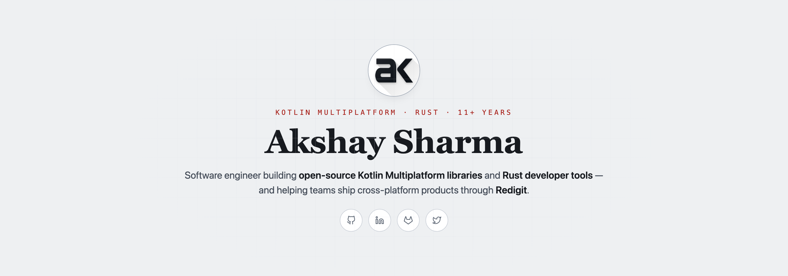

# akshay2211.github.io

Source for [ak1.io](https://ak1.io) — my personal site, blog, and project index.

<a href="https://ak1.io">
  <picture>
    <source media="(prefers-color-scheme: dark)" srcset="img/banner_dark.png">
    
  </picture>
</a>

## What's here

- **Home** — `index.html`
- **Projects** — `projects/index.html`, driven by `_data/projects.yml`
- **Blog** — Jekyll posts in `_posts/`
- **Hire** — `hire/index.html`, the Redigit consulting pitch
- **DrawBox live demo** — `demo/drawbox/index.html`, a Compose Multiplatform library running in-browser as WebAssembly
- **`llms.txt`** — curated entry point for language models, following [llmstxt.org](https://llmstxt.org)

## Stack

Static Jekyll site. Self-hosted Inter (UI), Newsreader (post body), and JetBrains Mono (code); design tokens (Radix Sand neutral scale + a swappable accent) in `css/tokens.css`. Vanilla CSS and JS — no build step, bundler, or framework beyond `jekyll build`. A visitor-facing Customize widget (`js/load.js`) lets readers switch accent color, corner style, and paper-grain intensity, persisted in `localStorage`. The one exception to "no dependencies": `js/vendor/anime.min.js`, a vendored copy of [anime.js](https://animejs.com) loaded only on the DrawBox demo page for its loading-state animation — every other page stays dependency-free. Comments via [Giscus](https://giscus.app).

## Run locally

```bash
bundle install
bundle exec jekyll serve
```

Then open <http://127.0.0.1:4000>.

## Forking this as a template

You're welcome to use this as a starting point for your own site. After forking:

1. Replace `CNAME` with your own domain (or delete it to serve from `you.github.io`).
2. Update `_config.yml` — `title`, `description`, `author`, `social.links`, `url`, and the `google_analytics` / `giscus` blocks (leave those blank to disable).
3. Swap the content: `_data/projects.yml` (Projects page + homepage + `llms.txt` all read from it), `_posts/`, and `img/`.
4. Design tokens live in `css/tokens.css` — change colours, type scale, and spacing there rather than in component CSS. The Customize widget's defaults (`APPEARANCE_DEFAULTS` in `js/load.js`) pick which accent/corner/grain a first-time visitor sees.
5. Star counts come from `.github/workflows/repo-stats.yml`, which writes `_data/stats.yml` on a schedule. It runs against your fork's owner automatically.

No build tooling to install beyond Ruby + Bundler.

---

By [Akshay Sharma](https://github.com/akshay2211).
